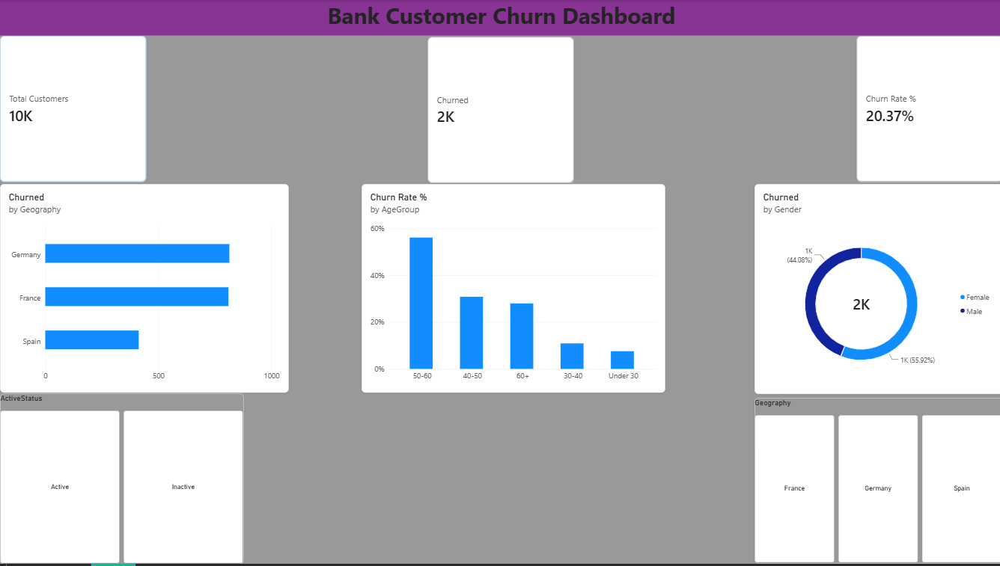

# 📊 Bank Customer Churn Analysis — Power BI Dashboard

An interactive Power BI dashboard analyzing bank customer churn behavior to identify high-risk segments, demographic trends, and key drivers impacting retention.

---

## 📌 Dashboard Preview


---

## 🎯 Project Overview
Customer attrition directly impacts banking profitability. This project analyzes customer demographic, financial, and behavioral attributes to uncover patterns behind churn and support proactive customer retention strategies.

---

## 🔑 Key Metrics (KPIs)
* **Total Customers:** 10,000
* **Total Churned:** ~2,037
* **Overall Churn Rate:** ~20.37%
* **Average Balance:** Analyzed across active vs. churned cohorts

---

## 💡 Key Business Insights
1. **Age Factor:** Churn rate spikes significantly in middle-aged and older customer brackets (ages 40–60), indicating retirement or transition risk.
2. **Geography Trends:** Germany and France account for the largest share of exited customers compared to Spain.
3. **Gender Breakdown:** Female customers exhibited a noticeably higher churn rate compared to male customers.
4. **Activity Status:** Inactive members churn at a substantially higher velocity than active account holders.

---

## 🛠️ Tech Stack & Tools
* **BI Tool:** Microsoft Power BI Desktop
* **Language / Modeling:** DAX (Data Analysis Expressions)
* **Visuals Used:** KPI Cards, Donut Chart, Clustered Bar & Column Charts, Slicers

---

## 📐 Key DAX Measures Used

```dax
// Total Customers
Total Customers = COUNTROWS('churn_cleaned')

// Churned Customers Count
Churned = CALCULATE([Total Customers], 'churn_cleaned'[Exited] = 1)

// Churn Rate Percentage
Churn Rate % = DIVIDE([Churned], [Total Customers])

// Average Account Balance
Avg Balance = AVERAGE('churn_cleaned'[Balance])
